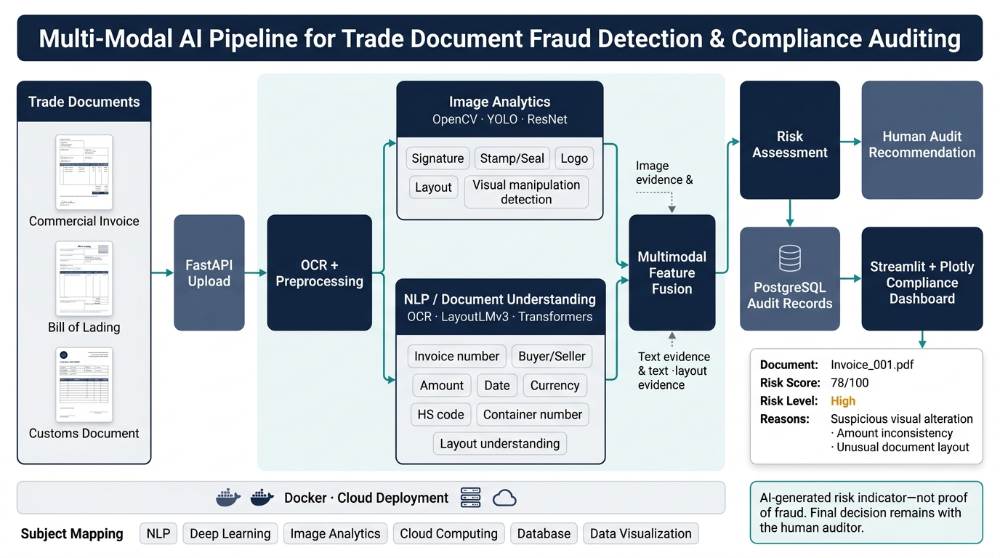

# Multi-Modal AI Pipeline for Trade Document Fraud Detection & Compliance Auditing

> **AI-generated risk indicator — not proof of fraud. Final decision remains with the human auditor.**

## Architecture Overview



## Project Structure

```
├── api/                    # FastAPI application & endpoints
│   ├── main.py             # Application entrypoint
│   ├── routes/             # API route handlers
│   ├── schemas/            # Pydantic request/response models
│   └── dependencies.py     # Dependency injection
├── core/                   # Pipeline orchestration
│   ├── pipeline.py         # Main multimodal pipeline
│   ├── config.py           # Configuration management
│   └── exceptions.py       # Custom exception hierarchy
├── preprocessing/          # OCR & document preprocessing
│   ├── ocr_engine.py       # Tesseract/EasyOCR integration
│   ├── image_prep.py       # Image normalization & enhancement
│   └── document_parser.py  # PDF/image extraction
├── image_analytics/        # Visual fraud detection
│   ├── signature_detector.py
│   ├── stamp_seal_detector.py
│   ├── logo_verifier.py
│   ├── layout_analyzer.py
│   └── manipulation_detector.py
├── nlp/                    # NLP & document understanding
│   ├── field_extractor.py  # Structured field extraction
│   ├── layout_lm.py        # LayoutLMv3 integration
│   └── entity_validator.py # Cross-field validation
├── fusion/                 # Multimodal feature fusion
│   ├── feature_combiner.py
│   └── evidence_aggregator.py
├── risk/                   # Risk assessment engine
│   ├── scorer.py           # Risk score computation
│   ├── rules.py            # Rule-based risk flags
│   └── recommender.py      # Human audit recommendation
├── db/                     # Database layer
│   ├── models.py           # SQLAlchemy ORM models
│   ├── session.py          # Database session management
│   └── migrations/         # Alembic migrations
├── dashboard/              # Streamlit + Plotly dashboard
│   ├── app.py              # Dashboard entrypoint
│   ├── pages/              # Multi-page dashboard
│   └── components/         # Reusable UI components
├── tests/                  # Test suite
│   ├── unit/
│   ├── integration/
│   └── fixtures/
├── docs/                   # Documentation & architecture
│   ├── architecture/
│   ├── process/
│   └── api/
├── docker/                 # Docker configuration
│   ├── Dockerfile
│   ├── Dockerfile.dashboard
│   └── docker-compose.yml
├── pyproject.toml          # Project metadata & dependencies
├── .env.example            # Environment variable template
└── Makefile                # Development commands
```

## Technology Stack

| Domain              | Technologies                                |
|---------------------|---------------------------------------------|
| **NLP**             | LayoutLMv3, Transformers, spaCy             |
| **Deep Learning**   | PyTorch, ResNet, YOLO                       |
| **Image Analytics** | OpenCV, Pillow, scikit-image                |
| **API**             | FastAPI, Pydantic, Uvicorn                  |
| **Database**        | PostgreSQL, SQLAlchemy, Alembic             |
| **Dashboard**       | Streamlit, Plotly                            |
| **Cloud/DevOps**    | Docker, Docker Compose                      |
| **OCR**             | Tesseract, EasyOCR                          |

## Live Presentation & Demo (University Project)

### 1. Run Live Pipeline Simulation (Console Demo)
Demonstrates the real-time multi-modal analysis cycle with staged terminal logs and the final audited result card:

```bash
python scripts/simulate_pipeline.py --document data/samples/Invoice_001.pdf
```

### 2. Launch the Streamlit Compliance Dashboard
Starts the interactive enterprise auditor portal with forensic bounding-box overlays, multimodal risk radar charts, and decision workflows:

```bash
streamlit run dashboard/app.py
```

### 3. Open Interactive Architecture Presentation Slide
Open the standalone responsive vector presentation deck in your browser:
```bash
# Double-click or open in browser:
docs/architecture/interactive_diagram.html
```

### 4. Run Automated Test Suite
Verify that all entity extraction, business consistency checks, and explainable risk scoring rules pass:
```bash
pytest tests/ -v
```

## Pipeline Flow

1. **Document Upload** → FastAPI receives trade documents (PDF/images)
2. **OCR + Preprocessing** → Text extraction and image normalization
3. **Parallel Analysis**:
   - **Image Analytics** → Visual inspection (signatures, stamps, logos, layout, manipulation)
   - **NLP / Document Understanding** → Field extraction and layout-aware comprehension
4. **Multimodal Feature Fusion** → Combines visual and textual evidence
5. **Risk Assessment** → Computes risk score and flags anomalies
6. **Human Audit Recommendation** → Generates actionable recommendation for human auditor
7. **Storage & Visualization** → PostgreSQL records + Streamlit dashboard

## License

MIT License — See [LICENSE](LICENSE) for details.
